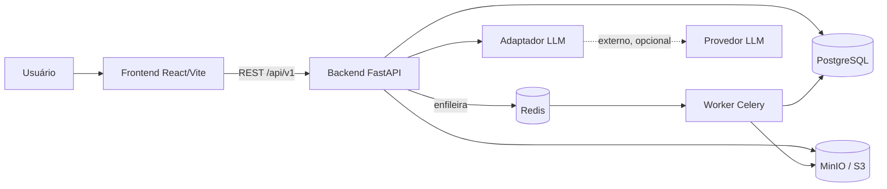
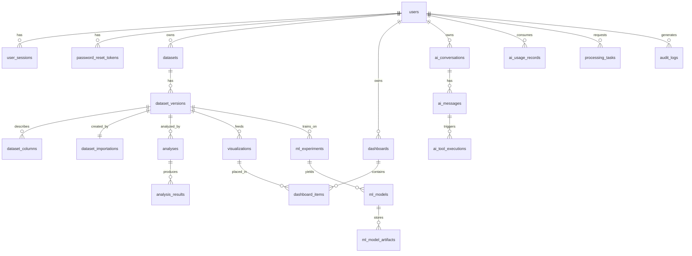

# Visão de arquitetura

## Estilo
Monólito modular com três processos: frontend (SPA), backend (API FastAPI) e worker (Celery, mesmo código do backend). Ver ADR-001.

## Componentes

## Camadas por módulo
`api → services (aplicação) → domain ← repositories/adapters (infraestrutura)`.
O domínio não importa FastAPI, SQLAlchemy nem SDKs de LLM.

## Modelo de dados inicial

Convenções: PK UUID; `created_at`/`updated_at` em todas as tabelas; `owner_id` em todo recurso de usuário. Linhas de planilha ficam em Parquet no object storage, nunca no PostgreSQL. Análises, visualizações e experimentos referenciam sempre `dataset_version_id`.

## Contratos da API
- Prefixo `/api/v1`; tipos TypeScript gerados do OpenAPI (ADR-005).
- Erros em RFC 9457 (`application/problem+json`), sem stack trace.
- Paginação: `page`, `page_size`, `sort`, `order` → `{items, total, page, page_size}`.
- Tarefas longas: `202 Accepted` + `task_id`; polling em `GET /tasks/{task_id}`; `Idempotency-Key` na criação.

## Fronteiras de confiança
Conteúdo de datasets é entrada não confiável (inclusive para o LLM). O LLM nunca executa SQL, Python ou comandos; só ferramentas validadas, que recebem `owner_id` do servidor.
